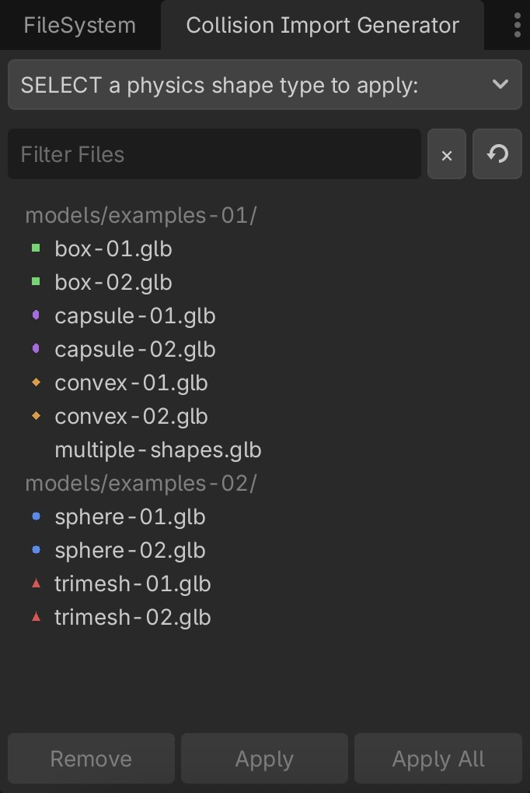

# Physics Collision Import Generator

This Godot plugin automatically generates physics bodies and collision shapes when importing 3D scenes from GLB/GLTF files. It also supports bulk processing of multiple assets, with potential support for additional formats in the future.

## Installation

1. Copy the `physics_collision_import_generator` folder to your project's `addons/` directory
2. Go to Project Settings → Plugins
3. Enable the "Physics Collision Import Generator" plugin

## Usage

1. Import GLB or GLTF files into your project
2. Open the **"Collision Import Generator"** dock panel (near the FileSystem dock)
3. Select one or more files from the list
4. Choose a physics shape type from the dropdown
5. Click **"Apply"** to add physics, or **"Remove"** to remove it

- Files with physics applied are shown with colored icons
- Use the search filter to find specific files/folders

## Features

- Automatically creates StaticBody3D nodes with CollisionShape3D for all MeshInstance3D nodes
- Multiple physics shape types supported
- Preserves existing scene structure
- Uses Godot's import script system to automatically process scenes during import

## Shape Types

- **Trimesh**: Exact mesh shape (best for static geometry)
- **Convex**: Convex hull approximation (good performance/accuracy balance)
- **Box**: Simple box shape based on mesh bounds
- **Sphere**: Simple sphere shape based on mesh bounds  
- **Capsule**: Simple capsule shape based on mesh bounds

## Notes

- Physics bodies are created as StaticBody3D by default
- Existing StaticBody3D nodes are reused when possible
- The plugin sets the **Import Script Path** in the file's `.import` configuration to automatically process scenes during import

## Preview

